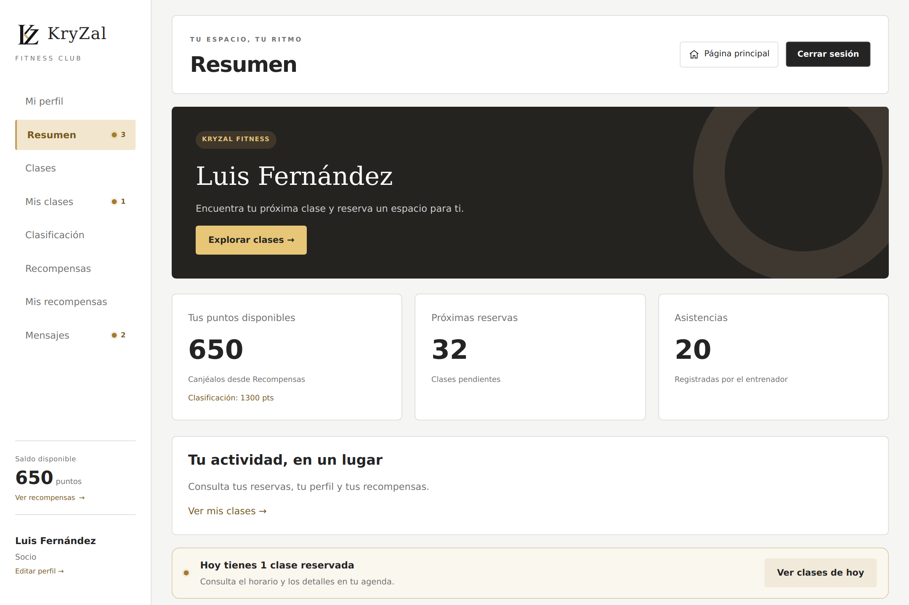
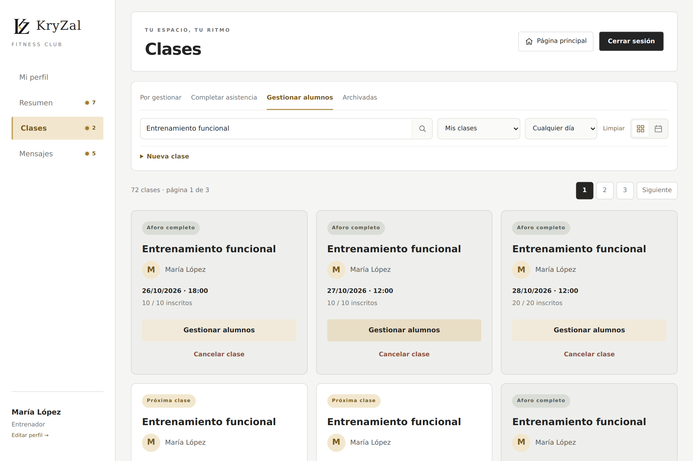
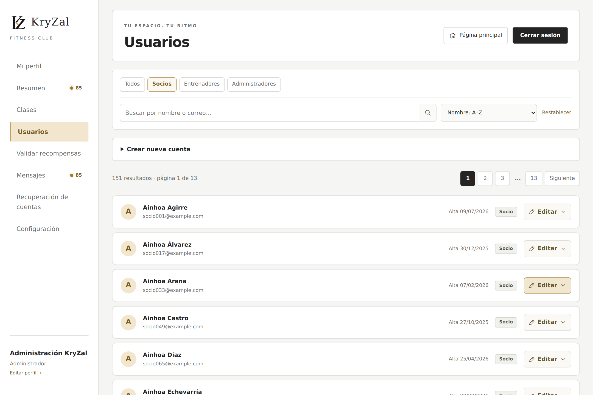

  

<h1 align="center">KryZal</h1>

Reservas, entrenamiento y gestión del gimnasio en una misma aplicación.

<strong>PHP 8 · MySQL / MariaDB · MVC · JavaScript · CSS</strong>

Aplicación web desarrollada como proyecto final del ciclo de **Desarrollo de Aplicaciones Web**. Incluye una web pública y espacios de trabajo para socios, entrenadores y administración.

[Manual en PDF](Documentacion/Guia_de_uso_KryZal.pdf) · [Guía en PowerPoint](Documentacion/Guia_de_uso_KryZal.pptx) · [Estructura del código](Documentacion/ESTRUCTURA_CODIGO.md)

## Qué permite hacer

| Perfil | Funciones |
| --- | --- |
| **Socios** | Reservar y cancelar clases, fijar reservas, consultar su actividad, participar en la clasificación, canjear recompensas y conversar con el equipo. |
| **Entrenadores** | Crear y gestionar sus clases, consultar alumnos, registrar asistencia y responder a consultas. |
| **Administración** | Gestionar todas las clases, cambiar entrenadores, administrar cuentas, corregir registros, validar recompensas y atender mensajes. |

La asistencia suma o resta puntos. La puntuación de clasificación y el saldo para recompensas se gestionan por separado. El historial conserva las clases completadas y canceladas, con sus informes.

Las reservas impiden ocupar dos clases a la misma fecha y hora. Cuando existe un conflicto, **Ver mi reserva** abre la sesión que ya ocupa ese horario.

## Un espacio para cada perfil

### Socios

Resumen de actividad, próximas reservas y saldo disponible.

### Entrenadores

Agenda con accesos por tarea: gestionar alumnos, completar asistencia y consultar el archivo.

### Administración

Gestión de usuarios con búsqueda, filtros por rol y ordenación por nombre o fecha de inscripción.

Las capturas utilizan cuentas de demostración. La interfaz se adapta a escritorio, tablet y móvil, en vertical y horizontal.

## Probar el proyecto

### Requisitos

- PHP 8.3 con PDO MySQL.
- MySQL 8 o MariaDB.
- Apache o un entorno local como WampServer.

### Configuración

1. Descarga o clona el repositorio.
2. Copia `FKryzal/app/config.example.php` como `FKryzal/app/config.php`.
3. Ajusta los datos de conexión a tu entorno. La plantilla utiliza `localhost:3306` y la base `kryzal_mejorado`.

`config.php` queda fuera del control de versiones para mantener privadas las credenciales de la base de datos y del correo.

### Instalación manual

1. Copia `FKryzal` a la carpeta `www` del servidor.
2. Crea `kryzal_mejorado` en phpMyAdmin con colación `utf8mb4_unicode_ci` e importa `FKryzal/sql/schema.sql`.
3. Abre `http://localhost/FKryzal/` y crea la cuenta inicial de administración.
4. Puedes marcar **Cargar demostración completa** para explorar la aplicación con actividad de ejemplo.

### Asistente para Windows

Después de preparar `config.php`, abre `Instalar_KryZal.exe` desde la carpeta del proyecto, fuera de `www`. El asistente prepara Wamp y crea el acceso directo del escritorio.

**Cada ejecución del instalador reinicia la base de datos de KryZal y sustituye la instalación anterior.** Para el uso diario, abre el acceso directo del escritorio.

## Demostración

La carga de ejemplo incluye **150 socios, 8 entrenadores y 2 administradores adicionales**, además de clases desde el día de instalación, historial, reservas, asistencias, recompensas y conversaciones.

| Perfil | Cuenta de demostración |
| --- | --- |
| Socio | `luis.fernandez@example.com` |
| Entrenador | `maria.lopez@example.com` |

Estas cuentas utilizan la contraseña **`KryzalDemo!7`**. La cuenta inicial de administración utiliza el correo y la contraseña que elijas durante la configuración.

## Organización

| Carpeta | Contenido |
| --- | --- |
| `FKryzal/app/` | Conexión, seguridad, sesiones y lógica común. |
| `FKryzal/Controlador/` | Navegación y acciones de los formularios. |
| `FKryzal/Modelo/` | Modelos y acceso a datos. |
| `FKryzal/Vista/` | Páginas públicas y vistas de cada perfil. |
| `FKryzal/assets/` | Estilos, JavaScript e imágenes. |
| `FKryzal/sql/` | Esquema de la base de datos. |
| `Instalador/` | Asistente y acceso del escritorio para Windows. |
| `Documentacion/` | Manuales, capturas y referencia del proyecto. |

Las consultas utilizan PDO con parámetros. Los formularios validan CSRF y permisos en el servidor. Las contraseñas se almacenan con hash. Las conversaciones y las fotos respetan los permisos de acceso de las cuentas.

Para ampliar la instalación y el funcionamiento, consulta la [referencia del proyecto](Documentacion/REFERENCIA.md) y la [guía de Wamp](Documentacion/GUIA_WAMP.txt).

## Autor

**Kimetz Andrés Elorza** · [LinkedIn](https://www.linkedin.com/in/kimetz-andres-elorza/) · [GitHub](https://github.com/KmtZz)
